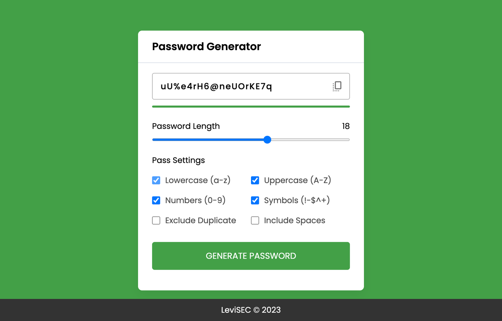

# Password Generator

A password generator in plain HTML, CSS and JavaScript.

Choose a length between 1 and 30 and which characters to use: lowercase and uppercase letters, numbers, symbols and spaces. You can also leave out repeated characters. The bar under the password shows how strong it is, and one click copies it.

Open `index.html` in a browser to use it; there is nothing to install.
